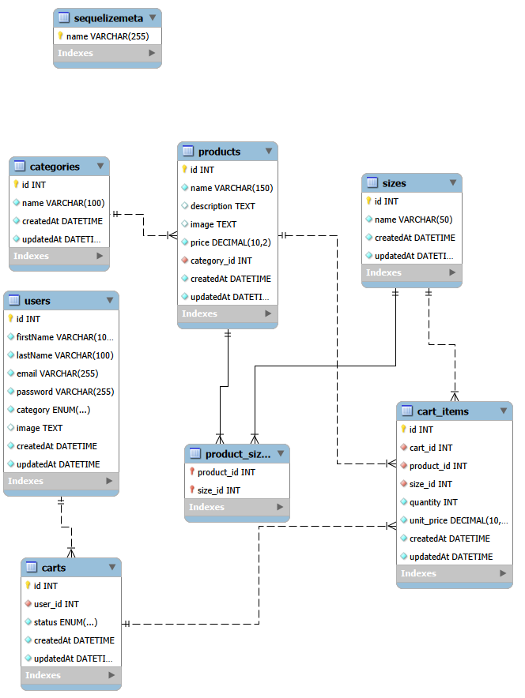

# 🥭 Manglü — Sprint 7: Validaciones (Back-end + Front-end)

Manglü es una aplicación web dedicada a la venta de granizados artesanales colombianos, desarrollada con **Node.js, Express y EJS**.

En el Sprint 6 se incorporó **MySQL** y **Sequelize** para almacenar productos, usuarios, categorías, tamaños y carritos de forma persistente. En el **Sprint 7** se protege esa base de datos: todos los formularios se validan en el **back-end con Express Validator** y en el **front-end con JavaScript**.

## 📋 Tablero de trabajo

**Enlace:** _(pegar aquí el enlace del tablero actualizado para el Sprint 7)_

## ✨ Funcionalidades del proyecto

### Funcionalidades desarrolladas en sprints anteriores

- Catálogo de productos y páginas de detalle.
- Creación, edición y eliminación de productos.
- Registro e inicio de sesión de usuarios.
- Cierre de sesión y perfil de usuario.
- Contraseñas cifradas mediante bcryptjs.
- Subida de imágenes con Multer.
- Middlewares de autenticación y control de acceso.
- Interfaz desarrollada con EJS, HTML, CSS y JavaScript.

### Funcionalidades implementadas en el Sprint 7

**Validaciones del back-end (Express Validator)** — `src/middlewares/validations/`

| Formulario | Reglas |
|---|---|
| Registro | Nombre y apellido: obligatorios, mínimo 2 caracteres. Email: obligatorio, formato válido y no repetido. Contraseña: obligatoria, mínimo 8 caracteres con mayúsculas, minúsculas, número y carácter especial. Confirmación igual a la contraseña. Términos aceptados. Imagen (opcional): JPG, JPEG, PNG o GIF. |
| Login | Email: obligatorio, válido y existente en la base. Contraseña: obligatoria y coincidente con la guardada (bcrypt). |
| Productos (crear y editar) | Nombre: obligatorio, mínimo 5 caracteres. Descripción: mínimo 20 caracteres. Precio mayor que 0. Imagen: archivo JPG, JPEG, PNG o GIF (obligatoria al crear, opcional al editar). Categoría y tamaños: deben existir en la base de datos. |
| Admin de usuarios (opcional) | Mismas reglas de nombre, email y contraseña; rol válido; email no repetido (al editar se ignora el propio usuario). |

- Las imágenes se suben con Multer (`src/middlewares/imageUpload.js`), con un máximo de 2 MB, y además se comprueba la **firma real del archivo** (no solo la extensión).
- Si algo es inválido se vuelve a mostrar el formulario con los mensajes y los datos escritos, y se borra la imagen subida.
- La base de datos sigue siendo la última barrera: el correo tiene índice único y las columnas obligatorias son `NOT NULL`.

**Validaciones del front-end (JavaScript)** — `public/js/validations.js`

- Cada formulario declara sus reglas en el HTML con `data-rules` (por ejemplo `data-rules="required|min:2"`), sin escribir un script por formulario.
- Se valida al salir de cada campo y en vivo al corregir; al enviar se bloquea el formulario si hay errores y el foco va al primer campo inválido.
- Registro y login consultan al servidor (`GET /api/email-exists`) para avisar si el correo ya existe o no existe.
- Es una ayuda para el visitante: el usuario puede desactivarla, por eso el back-end valida siempre.

**Correcciones sobre el Sprint 6**

- La foto de perfil por defecto apuntaba a `/images/users/default.svg`, pero el archivo vive en `public/img/users/`. Ahora se usa `/img/users/` (las rutas antiguas siguen funcionando).
- El formulario de administración de usuarios pisaba al usuario logueado en el encabezado.
- Las categorías y tamaños de los formularios de producto ahora salen de la base de datos.
- La imagen del producto pasó de ser un texto a un archivo subido.

### Funcionalidades implementadas en el Sprint 6

- Conexión de la aplicación con MySQL.
- Configuración de Sequelize.
- Creación de modelos y asociaciones.
- Migración del almacenamiento principal de productos y usuarios a la base de datos.
- Implementación del CRUD administrativo de usuarios.
- Persistencia de carritos y artículos.
- Creación de migraciones para reconstruir la estructura de la base de datos.
- Creación de seeders con información inicial del catálogo.
- Verificación de las migraciones y seeders en una base de datos de prueba.
- Elaboración del diagrama entidad-relación.

## 🛠️ Tecnologías utilizadas

| Tecnología | Función |
|---|---|
| Node.js | Entorno de ejecución |
| Express | Framework del servidor |
| EJS | Motor de plantillas |
| MySQL | Base de datos relacional |
| Sequelize | ORM y gestión de modelos |
| Sequelize CLI | Ejecución de migraciones y seeders |
| Express Validator | Validación de formularios en el back-end |
| bcryptjs | Cifrado de contraseñas |
| Multer | Subida de imágenes |
| express-session | Gestión de sesiones |
| dotenv | Variables de entorno |
| Git y GitHub | Control de versiones |

## 🗄️ Modelo de base de datos

La base de datos está compuesta por siete tablas principales:

| Tabla | Descripción |
|---|---|
| `users` | Información de los usuarios y sus roles |
| `categories` | Categorías del catálogo |
| `sizes` | Tamaños disponibles |
| `products` | Productos de Manglü |
| `product_sizes` | Relación entre productos y tamaños |
| `carts` | Carritos asociados a usuarios |
| `cart_items` | Artículos almacenados en cada carrito |

### Relaciones principales

- Una categoría puede contener varios productos.
- Un producto puede estar disponible en varios tamaños.
- Un tamaño puede asociarse a varios productos.
- Un usuario puede tener varios carritos.
- Un carrito puede contener varios artículos.
- Cada artículo del carrito está relacionado con un producto y un tamaño.

### Diagrama entidad-relación (DER)



El diagrama y el modelo editable de MySQL Workbench se encuentran en la carpeta `Docs/` (`DER_Manglu.pdf` y `Manglu_Modelo_ER.mwb`).

## 📂 Estructura principal del proyecto

```text
Desarrollo-Web-Sprint_7/
├── config/
│   └── config.js
├── Docs/
│   ├── DER_Manglu.pdf
│   └── Manglu_Modelo_ER.mwb
├── migrations/
│   ├── 20261105000100-create-users.js
│   ├── 20261105000200-create-categories.js
│   └── 20261105000300-create-remaining-tables.js
├── models/
├── seeders/
│   └── 20261105000400-demo-data.js
├── public/
│   ├── js/validations.js        ← validaciones del front-end
│   └── img/{users,products}     ← imágenes subidas
├── src/
│   ├── controllers/
│   ├── middlewares/
│   │   ├── imageUpload.js       ← Multer (JPG, JPEG, PNG, GIF)
│   │   └── validations/         ← Express Validator
│   ├── routes/
│   ├── views/
│   └── index.js
├── .env                         (local, no se sube)
├── .env.example
├── .gitignore
├── .sequelizerc
├── package.json
├── README.md
├── retro.md
└── daily.md
```

**Nota:** el archivo `.env` es local y no debe subirse al repositorio.

## 🌐 Funcionalidades y rutas

| Ruta | Función |
|---|---|
| `/` | Página principal |
| `/products` | Catálogo de productos |
| `/products/:id` | Detalle de producto |
| `/registro` | Registro de usuarios (validado) |
| `/login` | Inicio de sesión (validado) |
| `/api/email-exists` | Consulta si un correo existe (la usa el JavaScript del formulario) |
| `/perfil` | Perfil del usuario |
| `/carrito` | Carrito de compras |
| `/admin/users` | Administración de usuarios |

El sistema incluye operaciones para crear, consultar, actualizar y eliminar productos y usuarios, sujetas a los permisos establecidos en las rutas correspondientes.

## 🚀 Instalación y ejecución

### 1. Requisitos

- Node.js y npm.
- MySQL Server.
- MySQL Workbench (recomendado).
- Git.

### 2. Clonar el repositorio

```bash
git clone URL_DEL_REPOSITORIO
cd Desarrollo-Web-Sprint_7
```

Reemplazar `URL_DEL_REPOSITORIO` por el enlace real de GitHub.

### 3. Instalar dependencias

```bash
npm install
```

En el Sprint 7 se agregó `express-validator`; `npm install` lo instala y actualiza `package-lock.json`.

### 4. Configurar las variables de entorno

Copiar `.env.example` como `.env` en la raíz del proyecto y completar las variables:

```env
DB_HOST=localhost
DB_PORT=3306
DB_NAME=manglu_db
DB_USER=usuario_mysql
DB_PASSWORD=contraseña_mysql
SESSION_SECRET=clave_privada_de_sesion
```

Los valores deben corresponder a la instalación local de MySQL.

**Importante:** nunca publicar contraseñas reales ni el archivo `.env` en GitHub.

### 5. Crear la base de datos

Desde MySQL Workbench:

```sql
CREATE DATABASE IF NOT EXISTS manglu_db;
```

El usuario de MySQL configurado debe tener permisos suficientes sobre esta base de datos.

### 6. Ejecutar las migraciones

Para una base de datos nueva y vacía, ejecutar:

```bash
npx sequelize-cli db:migrate --env development
```

Las migraciones crean las siete tablas y sus relaciones.

**Advertencia:** no ejecutar las migraciones de creación sobre una base de datos que ya tenga las tablas creadas manualmente sin revisar primero su estado.

### 7. Ejecutar los seeders

Para cargar el catálogo inicial en una base de datos nueva:

```bash
npx sequelize-cli db:seed:all --env development
```

El seeder incluye:

| Datos iniciales | Cantidad |
|---|---:|
| Categorías | 3 |
| Tamaños | 4 |
| Productos | 9 |
| Relaciones producto-tamaño | 24 |
| **Total** | **40** |

Estos datos corresponden al catálogo inicial. No incluyen cuentas de usuario ni carritos personales.

### 8. Iniciar el servidor

```bash
npm start
```

Abrir en el navegador:

http://localhost:3000

## 🧪 Pruebas de validaciones (Sprint 7)

Lista para recorrer manualmente con el servidor encendido:

| Formulario | Prueba | Resultado esperado |
|---|---|---|
| Registro | Enviar vacío | Mensajes en todos los campos obligatorios; no se envía |
| Registro | Nombre de 1 letra | "debe tener al menos 2 caracteres" |
| Registro | Correo `abc` / correo ya registrado | Formato inválido / "Ya existe una cuenta con ese correo." |
| Registro | Contraseña `abcdefgh` | Pide mayúsculas, número y carácter especial |
| Registro | Foto `.pdf` o de más de 2 MB | Rechazada con mensaje |
| Registro | Archivo `.txt` renombrado a `.png` | Rechazado por el back-end (firma del archivo) |
| Login | Correo inexistente | "No existe una cuenta con ese correo." |
| Login | Contraseña equivocada | "La contraseña es incorrecta." |
| Producto | Nombre de 4 caracteres, descripción de 19, precio 0 | Cada campo muestra su error |
| Producto | Sin imagen al crear / con imagen al editar vacío | Obligatoria al crear; al editar se conserva la actual |
| Producto | Categoría o tamaño inexistente (alterando el HTML) | Rechazado por el back-end |
| Todos | Desactivar JavaScript en el navegador | El back-end igual rechaza los datos inválidos |

## 🧪 Pruebas realizadas (Sprint 6)

Se utilizó una base de datos independiente llamada `manglu_test` para comprobar el funcionamiento de las migraciones y seeders.

Se verificó:

- Creación de las siete tablas mediante migraciones.
- Creación de las relaciones y claves foráneas.
- Inserción de los 40 registros iniciales.
- Consulta de los registros desde MySQL Workbench.
- Funcionamiento del CRUD de productos.
- Funcionamiento del CRUD administrativo de usuarios.
- Persistencia del carrito de compras.
- Conservación de los datos tras reiniciar el servidor.

La base de datos principal `manglu_db` se mantuvo separada de las pruebas.

## 🔒 Seguridad

- Las contraseñas de usuarios se almacenan cifradas.
- Se utilizan sesiones para la autenticación.
- Las rutas protegidas requieren iniciar sesión.
- Las funcionalidades administrativas están restringidas según el rol.
- Las credenciales de la base de datos se configuran mediante variables de entorno.
- El archivo `.env` debe excluirse del repositorio mediante `.gitignore`.

## 📝 Documentación ágil

- `retro.md`: retrospectiva del Sprint 6 (starfish).
- `daily.md`: impresiones sobre las dailys/weeklys.
- `Docs/DER_Manglu.pdf`: diagrama entidad-relación.
- `Docs/Manglu_Modelo_ER.mwb`: modelo editable de la base de datos.
- Tablero de trabajo: enlace en la sección «Tablero de trabajo».

## 👥 Equipo de desarrollo

- **Oscar Javier Hernández Morales** — Sistemas / Desarrollo Web
- **Juan David Navarro Jiménez** — Sistemas / Desarrollo Web

## 🎯 Conclusión del Sprint 7

Las validaciones en dos capas (front-end para la experiencia, back-end y base de datos para la seguridad) evitan que datos inválidos lleguen a la base y dan mensajes claros al visitante. Además se corrigieron detalles heredados del Sprint 6.

## 🎯 Conclusión del Sprint 6

Durante este sprint se fortaleció la arquitectura de Manglü mediante la implementación de una base de datos relacional con MySQL y Sequelize. Esto permitió reemplazar el almacenamiento principal basado en archivos JSON por un sistema persistente, organizar las relaciones entre las entidades y mejorar la administración de usuarios, productos y carritos.

Adicionalmente, las migraciones y seeders permiten reproducir la estructura y los datos iniciales del catálogo en una nueva base de datos, facilitando las pruebas, el mantenimiento y la continuidad del desarrollo.
